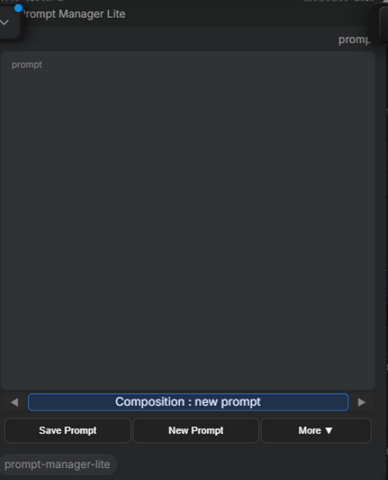
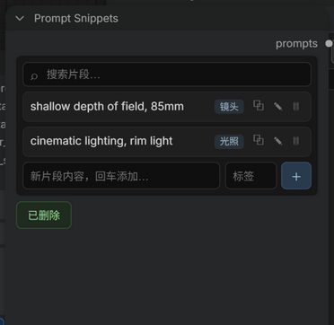

# ComfyUI Prompt Manager Lite

A minimal prompt library manager for ComfyUI — just two nodes, nothing else.



Prompt Manager Lite is a stripped-down alternative to
[ComfyUI-Prompt-Manager](https://github.com/FranckyB/ComfyUI-Prompt-Manager)
for people who only use its core: a prompt library, a text editor, and a
prompt output. No LoRA stacks, no trigger words, no recipe/workflow features.

## Features

- **Works in both renderers** — including the new Vue nodes (2.0) mode, where
  the original plugin's UI glitches (stretched / collapsed widgets, misplaced
  DOM overlays). Resize-safe by design: the text area absorbs all extra space
  while the selector and button bar stay fixed.
- **Prompt Manager Lite node**: category/prompt selector, multiline
  text editor, and a single `prompt` (STRING) output.
- **Thumbnail browser** — the full prompt browser from the original plugin
  (grid view, NSFW filter, thumbnails, create/rename/delete categories,
  import/export JSON).
- **Button bar** — `Save Prompt` (opens the browser in save mode),
  `New Prompt`, and a `More ▼` menu (delete prompt / export / import JSON).
- **◀ ▶ navigation** — flip through every prompt across all categories.
- **Unsaved-changes warning** (configurable in Settings → Prompt Manager Lite).

## Prompt Snippets node

A note-like companion node that holds a searchable list of short, reusable
text fragments — quality tags, camera/lighting phrases, negative prompts,
weight tricks.



- **Search** filters snippets by content and tag in real time; add new ones
  with an optional tag at the bottom.
- **Click a snippet** to copy it to the clipboard *and* send it to the node's
  `prompts` (STRING) output, so it can be wired straight into any prompt
  input. The output value is saved with the workflow.
- Inline edit (✎) and delete (🗑) per snippet.
- All snippet nodes share one library stored in a **dedicated file**
  (`user/default/prompt_snippets.json`) — completely separate from the
  prompt-manager library, so snippet data never mixes with thumbnail-capable
  prompt records.

## Compatibility with the original Prompt Manager

Prompt Manager Lite reads and writes the **same library file** as the
original plugin:

```
ComfyUI/user/default/prompt_manager_data.json
```

Your existing prompt library works with zero migration, and both plugins can
be installed at the same time. The file lives in ComfyUI's user directory, so
uninstalling either plugin never touches your data. Lite only manages the
prompt text (plus thumbnail/NSFW flags); any LoRA / trigger-word / workflow
data already stored on a record is preserved untouched.

## Installation

### Via ComfyUI Manager

Use *Install via Git URL* with:

```
https://github.com/Martlet-Tech/comfyui-prompt-manager-lite
```

(Once listed in the ComfyUI Manager registry it will also appear in the
regular node search.)

### Manual

```bash
git clone https://github.com/Martlet-Tech/comfyui-prompt-manager-lite \
    ComfyUI/custom_nodes/prompt-manager-lite
```

Restart ComfyUI afterwards. The nodes appear in the node search as
**Prompt Manager Lite** and **Prompt Snippets**.

## HTTP API

The frontend talks to `/prompt-manager-lite/*` (get-prompts, save-prompt,
save-category, rename-category, delete-category, delete-prompt, rename-prompt,
save-thumbnail, toggle-nsfw, import/export), so it never conflicts with the
original plugin's endpoints even when both are loaded.

## Credits

The thumbnail browser is reused from
[FranckyB/ComfyUI-Prompt-Manager](https://github.com/FranckyB/ComfyUI-Prompt-Manager)
(MIT, © François Beaudry). Prompt Manager Lite is an independent,
trimmed-down build — it is not affiliated with the original project.

## License

MIT — see [LICENSE](LICENSE).
